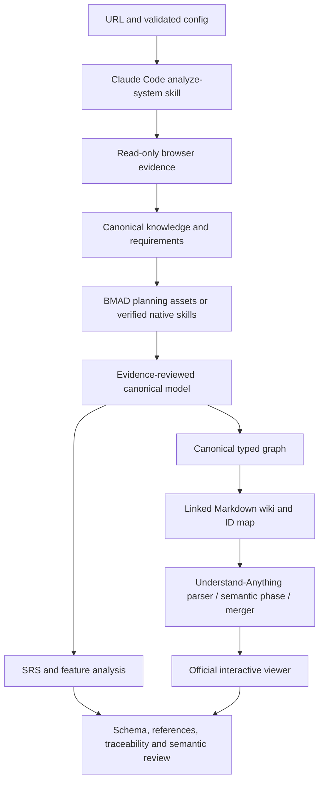

# Architecture

Claude Code owns discovery, interpretation, planning decisions and semantic review. A project-local skill guides nine stages. Python scripts validate and export persisted canonical data; none call an LLM. Upstream checkouts are separate from the custom skill.

BMAD current mode is adapted templates plus real upstream memory execution. UA current mode is real deterministic phases plus real viewer; semantic phase remains blocked. Native model stages are not silently emulated by Python.

Canonical graph uses business types System, Module, Actor, Feature, Requirement, Workflow, Step, Entity, BusinessRule, Evidence and OpenQuestion. Each node exports to an upstream article. Wikilinks produce upstream `related` edges; canonical relation semantics and provenance remain in canonical.json and linked JSON. ID mapping preserves requirement identity even though upstream types differ.

Run manifest keeps timestamps, dependency hashes, stage states, artifacts and errors. The sequential dependency model conservatively invalidates downstream states after changed inputs or outputs. It does not delete stale evidence. Relative run paths and repo-prefixed source paths make checkpoints portable. Raw reasoning may vary; persisted evidence and models reproduce deterministic exports.

Browser helper enforces origin/private-address checks on requests and redirects, safe network methods, persistent page/action budgets and an elapsed helper deadline. Timeout is per operation; a pending operation can run until its bounded timeout after the deadline. Claude reasoning is not forcibly globally timed. Source text never enters a command interpreter. No external accounts, backend, graph database or hosted application are needed.
